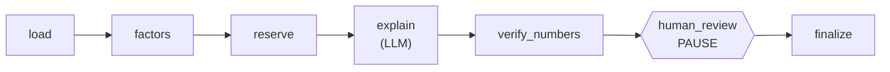

# Agent d'aide au provisionnement (Chain-Ladder, LangGraph, validation humaine)

Un workflow IA qui aide un actuaire à estimer la **provision** d'un portefeuille (combien l'assureur doit encore payer pour des sinistres déjà survenus), en séparant strictement :

- le **calcul**, fait par des outils déterministes (jamais par le LLM) ;
- le **langage**, rédigé par un LLM à partir des seuls chiffres calculés ;
- la **décision**, prise par un humain (Human-in-the-Loop).

Les données sont le jeu d'exemple `clrd` de la bibliothèque [`chainladder`](https://github.com/casact/chainladder-python) : des triangles de sinistres d'assureurs américains (775 triangles, 6 branches, années 1988 à 1997).

## Ce que fait l'agent

1. **Charger** le triangle d'une branche (`wkcomp`, `ppauto`, ...).
2. **Calculer les facteurs de développement** (moyenne pondérée par les volumes).
3. **Estimer la provision** avec la méthode Chain-Ladder.
4. **Expliquer** le résultat en français clair (LLM ou gabarit).
5. **Vérifier les chiffres** : tout nombre cité doit provenir des outils, sinon l'explication est remplacée par un gabarit sûr.
6. **S'arrêter et demander la validation d'un actuaire** avant de conclure.

## Architecture



| Fichier | Rôle |
|---|---|
| `src/provisionnement/tools.py` | Outils de calcul (numpy) : chargement, facteurs, provision |
| `src/provisionnement/schemas.py` | Modèles Pydantic des données échangées |
| `src/provisionnement/guard.py` | Garde-fou « aucun chiffre inventé » |
| `src/provisionnement/llm.py` | Explicateurs : gabarit (sans LLM) et Claude |
| `src/provisionnement/graph.py` | Graphe LangGraph, interruption pour validation humaine |
| `src/provisionnement/api.py` | API FastAPI |
| `src/provisionnement/evaluation.py` | Métriques d'évaluation |
| `scripts/evaluate.py` | Lance l'évaluation et écrit `results/` |

**Choix clé.** Les calculs sont réimplémentés en numpy dans `tools.py`, et `chainladder` sert de **référence indépendante** pour les tests et l'évaluation. Si l'agent utilisait `chainladder` pour calculer, comparer l'agent à `chainladder` donnerait zéro par construction et ne prouverait rien.

## Installation

Python 3.12 recommandé (version utilisée en CI et dans Docker).

```powershell
python -m venv .venv
.\.venv\Scripts\Activate.ps1          # Linux/Mac : source .venv/bin/activate
python -m pip install -r requirements.txt
```

## Tests

```powershell
python -m pytest -q
```

Les tests n'appellent aucun LLM et n'ont besoin d'aucune clé : ils utilisent l'explicateur par gabarit et des explicateurs « menteurs » écrits pour l'occasion.

## Lancer l'API

```powershell
$env:PYTHONPATH = "src"
python -m uvicorn provisionnement.api:app --port 8000
```

Ouvre <http://localhost:8000/docs> (interface interactive) :

1. `POST /runs` avec `{"branch": "wkcomp"}` : l'agent calcule, explique, puis **s'arrête** (`status: awaiting_validation`).
2. `POST /runs/{run_id}/review` avec `{"approved": true, "comment": "..."}` : l'agent conclut (`validated` ou `rejected`).
3. `GET /runs/{run_id}` : consulter l'état.

## Utiliser Claude et LangSmith (optionnel)

Par défaut, l'explication vient d'un gabarit (sans LLM). Pour utiliser Claude et tracer chaque étape :

```powershell
$env:ANTHROPIC_API_KEY = "..."
$env:EXPLAINER = "claude"
$env:LANGSMITH_TRACING = "true"
$env:LANGSMITH_API_KEY = "..."
$env:LANGSMITH_PROJECT = "provisionnement-agent"
```

Chaque nœud du graphe apparaît alors comme une étape dans LangSmith. Ce chemin (Claude + LangSmith) n'est exercé ni par les tests ni par la CI, qui n'ont pas de clé.

## Évaluation

```powershell
python scripts/evaluate.py --n-companies 100 --seed 0                # gabarit
python scripts/evaluate.py --n-companies 100 --seed 0 --explainer claude   # vrai LLM
```

Trois mesures, écrites dans `results/` :

1. **Écart avec la référence** : `|provision agent - provision chainladder| / provision chainladder`, sur les 6 branches et un échantillon d'assureurs tiré avec une graine fixe.
2. **Fidélité des chiffres** : part des explications dont tous les nombres figurent dans les résultats des outils.
3. **Détection du garde-fou** : on injecte un faux chiffre dans un texte correct, et on mesure la part de faux chiffres repérés.

### Résultats (graine 0 : 6 branches et 100 assureurs tirés au hasard)

| Indicateur | Valeur |
|---|---|
| Triangles évalués / demandés | 52 sur 106 (54 non évaluables, voir Limites) |
| Écart relatif moyen | 2,97e-16 |
| Écart relatif maximal | 1,61e-15 |
| Explications sans chiffre inventé (gabarit, sans LLM) | 6 sur 6 |
| Faux chiffres injectés détectés par le garde-fou | 6 sur 6 |

Les explications évaluées ici sont celles du gabarit, sans LLM : ce 6 sur 6 est attendu et ne mesure pas un modèle de langage. La mesure avec Claude se lance avec `--explainer claude` et une clé API.

## CI et Docker

- `.github/workflows/ci.yml` lance les tests à chaque `push` et pull request.
- `Dockerfile` : `docker build -t provisionnement-agent .` puis `docker run -p 8000:8000 provisionnement-agent`.

## Limites

- C'est un **workflow à parcours fixe** avec un nœud LLM et une validation humaine, pas un agent qui choisit librement ses outils.
- Une seule méthode (Chain-Ladder), sans facteur de queue, et sans mesure de l'incertitude de la provision.
- Le garde-fou vérifie que chaque nombre cité **existe** dans les résultats, pas qu'il est cité **au bon endroit** (un total pris pour un autre passerait), ni que la conclusion est juste. Il est strict sur le format : un chiffre arrondi ou écrit avec des séparateurs de milliers est signalé.
- Les triangles non standard (trou dans la dernière diagonale, montants négatifs, colonnes à zéro) sont **refusés** plutôt que devinés : c'est le cas d'environ la moitié des triangles d'assureurs de `clrd`. Les six triangles par branche sont tous évaluables.
- Un écart de l'ordre de 1e-15 avec `chainladder` est attendu : les deux appliquent la même méthode. Il valide l'implémentation, pas la pertinence actuarielle de la méthode.
- Les données couvrent 1988 à 1997 et ne représentent pas un portefeuille actuel.
- Les runs sont gardés en mémoire (`InMemorySaver`) et perdus au redémarrage du serveur.
